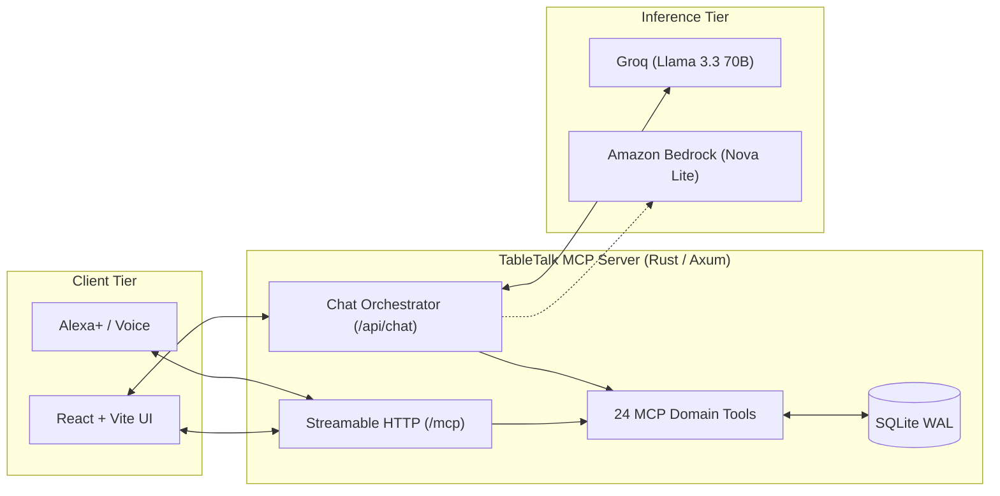

# TableTalk

> Intelligent restaurant assistant MCP server powering voice-driven dining interactions, capacity negotiation, allergen-safe search, and frictionless bookings.

[](https://github.com/dhanushkumar-amk/TableTalk/actions/workflows/ci.yml)
[](LICENSE)
[](https://modelcontextprotocol.io/)

TableTalk is a production-hardened restaurant server implementing the **Model Context Protocol (MCP)** over Streamable HTTP (spec version `2025-11-25`). Built in Rust with Axum, Tokio, and SQLite WAL persistence, it pairs with a React assistant frontend that renders accessible UI cards for voice assistants like Amazon Alexa+.

---

## Screenshots

| Voice Assistant & Negotiation | Allergen-Safe Menu Discovery |
| :---: | :---: |
|  |  |
| *Ranked alternatives and short-lived table holds* | *Transparent ingredient and cross-contact disclosures* |

---

## Features

- **24 Compliant MCP Tools**: Covers full dining lifecycle across 5 distinct domains.
- **Smart Dining Room Negotiation**: Evaluates table inventories, detects fully booked slots, and returns deterministically ranked alternatives with explainable scoring.
- **Short-Lived Table Holds**: Places 5-minute atomic holds with cryptographic offer tokens to prevent table snatching during conversation turns.
- **Uncompromising Allergen Safety**: Prohibits false safety claims (`guaranteed`, `allergy-free`), flags cross-contact risks, and requires explicit diner confirmation.
- **Integer Paise Money Arithmetic**: Eliminates floating-point currency drift with overflow-checked minor units.
- **Privacy-Preserving Memory**: Remembers dining preferences only with explicit consent; stores profile tokens as SHA-256 hashes; provides permanent "Forget Me" hard deletion.
- **The Human-Confirms Payment Rule**: The AI assistant *never* handles card data or approves payments; all deposits require human confirmation through secure links.
- **Dual LLM Provider Support**: Native tool calling with Groq Llama 3.3 70B (sub-300ms time-to-first-token) and Amazon Bedrock with Amazon Nova Lite (`apac.amazon.nova-lite-v1:0`).

---

## Architecture



Detailed architecture specifications, sequence flows, and concurrency models are available in [docs/ARCHITECTURE.md](docs/ARCHITECTURE.md).

---

## Quick Start

### Option A: Local Development

#### 1. Prerequisites
- Rust stable toolchain (`1.80+`)
- Node.js `20+` LTS
- Git & curl

#### 2. Start Backend
```bash
# Runs migrations, applies deterministic seed data, and listens on port 8080
cargo run --manifest-path backend/Cargo.toml --bin mcp_tabletalk_backend
```

#### 3. Start Frontend
```bash
cd frontend
npm install
npm run dev
```
Open [http://localhost:5173/assistant](http://localhost:5173/assistant) in your browser.

#### 4. Verify Health & Readiness
```bash
curl http://localhost:8080/health
# {"status":"ok"}

curl http://localhost:8080/ready
# {"status":"ready","database":"connected"}
```

---

### Option B: Docker Compose

Run both the backend and frontend with a single command:
```bash
docker compose up --build
```
- Backend: [http://localhost:8080](http://localhost:8080)
- Frontend: [http://localhost:5173](http://localhost:5173)

---

## Configuration

All configuration is loaded from environment variables (or `.env` file) with safe defaults and fail-fast validation:

| Variable | Default | Purpose |
| :--- | :--- | :--- |
| `PORT` | `8080` | Port for Axum HTTP and MCP server |
| `ALLOWED_ORIGINS` | `http://localhost:5173,http://127.0.0.1:5173,http://localhost:8080,http://127.0.0.1:8080` | Origin allowlist to prevent DNS rebinding |
| `RUST_LOG` | `info,tabletalk_backend=debug` | Tracing log filter |
| `DATABASE_URL` | `sqlite://data/tabletalk.db` | SQLite database URI |
| `SEED_ON_START` | `false` | Idempotently seeds initial restaurant data if empty |
| `RESTAURANT_TZ` | `Asia/Kolkata` | Restaurant timezone for capacity scheduling |
| `REQUEST_TIMEOUT_SECS` | `30` | Request timeout ceiling |
| `RATE_LIMIT_PER_MINUTE` | `600` | Per-IP rate limit for general endpoints |
| `LLM_PROVIDER` | `groq` | Conversational inference provider (`groq` or `bedrock`) |
| `GROQ_API_KEY` | *(None)* | API key for Groq Cloud |
| `GROQ_MODEL` | `llama-3.3-70b-versatile` | Model name for Groq completions |
| `AWS_REGION` | `ap-south-1` | AWS Region for Amazon Bedrock runtime |
| `BEDROCK_MODEL_ID` | `apac.amazon.nova-lite-v1:0` | Bedrock inference model profile |
| `CHAT_MAX_TOKENS` | `500` | Output token limit per chat turn |
| `CHAT_SESSION_TOKEN_BUDGET` | `10000` | Token limit per chat session |
| `CHAT_DAILY_TOKEN_BUDGET` | `50000` | Daily token circuit breaker |
| `CHAT_RATE_LIMIT_PER_MINUTE` | `30` | Per-IP rate limit for conversational chat endpoint |
| `CHAT_MAX_MESSAGE_LEN` | `1000` | Maximum character length for user chat prompts |

---

## MCP Tools Reference

TableTalk registers 24 compliant tools with JSON Schema Draft 2020-12 inputs and outputs:

| Tool Name | Domain | Annotations | Description |
| :--- | :--- | :--- | :--- |
| `ping_restaurant` | Core | `read_only` | Liveness and connectivity check returning restaurant name and clock. |
| `search_menu` | Menu | `read_only` | Allergen-aware menu search with dietary filters and transparent cross-contact notices. |
| `check_availability` | Availability | `read_only` | Real-time dining table capacity check for requested party size and time. |
| `create_booking` | Booking | `idempotent` | Confirm reservation directly when table is open. |
| `get_booking` | Booking | `read_only` | Retrieve existing reservation status by confirmation code. |
| `cancel_booking` | Booking | `destructive` | Cancel an active table reservation. |
| `negotiate_booking` | Negotiation | `read_only` | Evaluate fully-booked slots and return ranked alternative options with scores. |
| `accept_offer` | Negotiation | `idempotent` | Place a 5-minute hold on a negotiated option or convert hold to confirmed booking. |
| `release_offer` | Negotiation | `destructive` | Manually release an active table hold before expiration. |
| `join_waitlist` | Waitlist | `idempotent` | Join FIFO dining waitlist for preferred time window. |
| `get_waitlist_status` | Waitlist | `read_only` | Check waitlist position and inspect table offers. |
| `leave_waitlist` | Waitlist | `destructive` | Remove party from dining waitlist. |
| `place_order` | Ordering | `idempotent` | Place pickup order with checked paise pricing and prep time estimation. |
| `get_order` | Ordering | `read_only` | Retrieve pickup order status and item breakdown. |
| `cancel_order` | Ordering | `destructive` | Cancel pickup order prior to kitchen preparation cutoff. |
| `get_deposit_status` | Deposits | `read_only` | Check status of deposit requirement for peak reservations. |
| `refresh_payment_session`| Deposits | `idempotent` | Regenerate payment link for pending deposits. |
| `simulate_deposit_payment`| Deposits | `idempotent` | Simulated human payment confirmation (mock checkout). |
| `enable_memory` | Memory | `idempotent` | Opt in to preference memory with explicit diner consent. |
| `get_profile` | Memory | `read_only` | Retrieve stored dining preferences using profile token. |
| `remember_preference` | Memory | `idempotent` | Save dietary preference or favorite seating area. |
| `forget_preference` | Memory | `destructive` | Delete a single stored preference record. |
| `get_usual_order` | Memory | `read_only` | Retrieve personalized frequent order recommendation re-validated against live menu. |
| `forget_me` | Memory | `destructive` | Hard delete guest profile, all preferences, and scrub PII. |

---

## Testing & Quality Assurance

TableTalk is comprehensively tested across 16 integration suites, fuzz testing, and protocol verification:

```bash
# 1. Rust Formatting & Lints
cargo fmt --check
cargo clippy --all-targets -- -D warnings

# 2. Rust Unit & Integration Tests (110 tests)
cargo test

# 3. Frontend Lint, Typecheck, and Unit Tests (83 tests)
cd frontend
npm run lint
npm test -- --run
npm run build
cd ..

# 4. MCP Protocol Smoke Tests & Inspector CLI
./scripts/smoke-test.sh

# 5. Security & Secret Scan over Full Git History
node scripts/secret-scan.cjs

# 6. Database Point-in-Time Backup Test
./scripts/backup.sh
```

---

## Demo Script

Follow the step-by-step 3-minute recording script in [docs/DEMO_RUNBOOK.md](docs/DEMO_RUNBOOK.md), including:
- 0:00 - 0:30: The Hook (Voice Negotiation on Fully Booked Friday 7:30 PM slot)
- 0:30 - 1:00: Table Confirmation & Interactive Booking Card
- 1:00 - 1:45: Allergy-Aware Menu Search (Vegan & Peanut Exclusion)
- 1:45 - 2:25: Pickup Order Placement & Prep Tracking
- 2:25 - 2:50: Privacy & "Forget Me" Hard Memory Scrubbing
- 2:50 - 3:00: Architecture Wrap-Up

---

## Hackathon Submission Details

- **Event**: Amazon Developer Hackathon (Alexa+ Track)
- **Submission Document**: Complete copy-paste submission kit available in [docs/SUBMISSION.md](docs/SUBMISSION.md).
- **Product Feedback**: Full five-question platform feedback for the Rust MCP SDK, Streamable HTTP, SQLx, and AWS Bedrock available in [docs/PRODUCT_FEEDBACK.md](docs/PRODUCT_FEEDBACK.md).
- **Friction Log**: Chronological engineering obstacles and workarounds in [docs/FRICTION_LOG.md](docs/FRICTION_LOG.md).
- **Production Gap Analysis**: Honest appraisal of demo state vs enterprise production in [docs/PRODUCTION_READINESS.md](docs/PRODUCTION_READINESS.md).

---

## Limitations

1. **Simulated Payments**: Financial transactions use mock checkout links; no real credit card networks are touched.
2. **Single-Node SQLite**: Designed for low-latency single-instance embedded use with WAL mode.
3. **Polling-Only Waitlist**: Waitlist notifications are checked on demand via `get_waitlist_status`.
4. **Alexa+ Custom Visual Cards**: Alexa+ third-party custom UI card rendering on Echo Show hardware is **UNVERIFIED** due to pre-release developer guidelines; SSML and spoken voice formatting are 100% verified.

---

## License

This project is licensed under the [MIT License](LICENSE).
Copyright (c) 2026 [YOUR NAME / TABLETALK AUTHORS - REPLACE WITH YOUR NAME]
