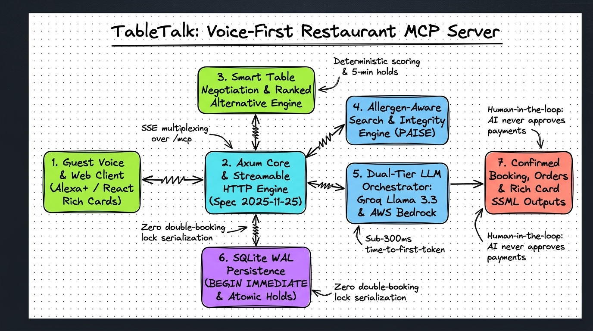
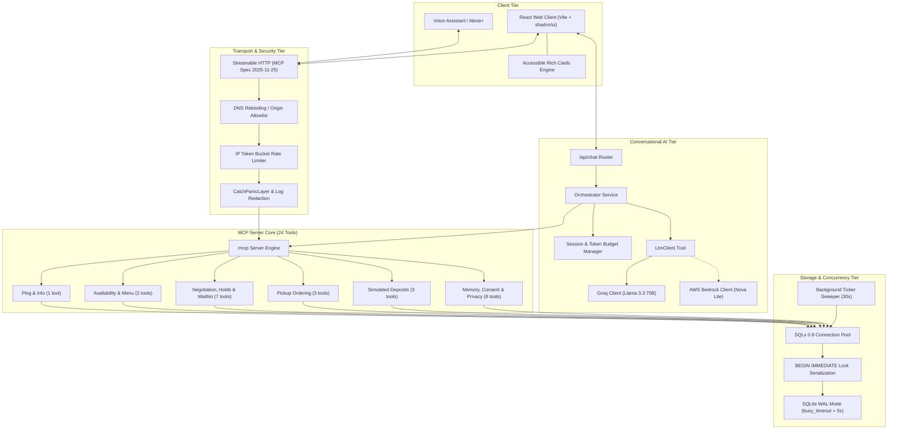
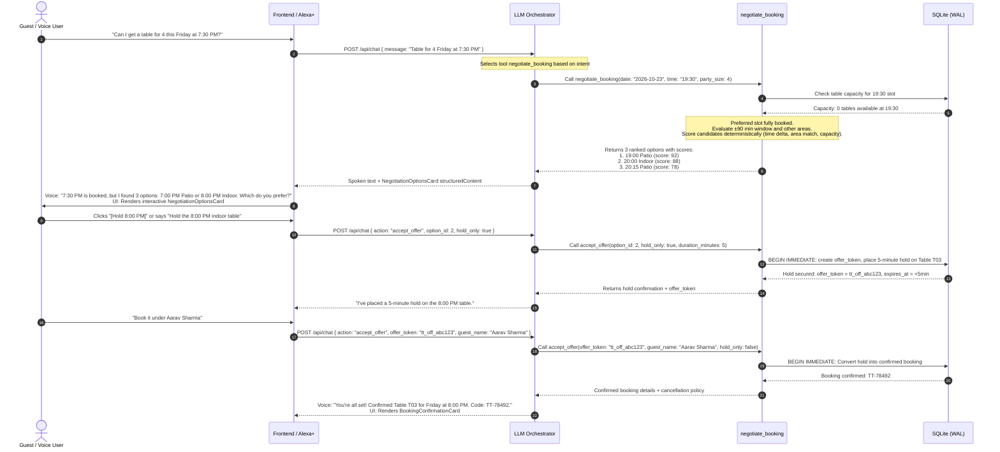

# TableTalk Architecture

> System architecture, data flow, concurrency design, and safety boundaries for the TableTalk Restaurant MCP Server.

---

## 1. High-Level System Architecture

TableTalk is built as a single-binary, high-performance restaurant Model Context Protocol (MCP) server written in Rust (Axum, Tokio, rmcp) paired with a responsive React frontend client (Vite, TypeScript, Tailwind CSS, shadcn/ui).

---

## 2. Core Components

### 2.1 Transport Layer (`backend/src/http.rs`)
- **Specification**: Model Context Protocol over Streamable HTTP (spec version `2025-11-25`).
- **Endpoint**: Single multiplexed path `/mcp` supporting both JSON-RPC requests and Server-Sent Events (SSE).
- **Security Controls**:
  - `validate_origin`: Rejects non-allowlisted browser `Origin` headers with HTTP 403 to prevent DNS rebinding attacks while permitting CLI/voice assistant headers.
  - `validate_protocol_version`: Validates `mcp-protocol-version` header against supported versions (`2025-11-25`, `2024-11-05`), rejecting mismatches with HTTP 400.
  - `validate_body_size`: Enforces strict 2MB body limit with HTTP 413.
  - `IpRateLimiter`: Per-IP sliding-window rate limiter protecting against brute-force resource exhaustion.
  - `request_id_and_tracing`: Attaches unique UUID `x-request-id` to every request and redacts sensitive tokens before logging.
  - `CatchPanicLayer`: Catches unexpected thread panics and returns safe generic HTTP 500 without leaking stack traces.

### 2.2 Health & Readiness (`/health` & `/ready`)
- **`/health`**: Returns HTTP 200 `{"status":"ok"}` immediately for liveness probes.
- **`/ready`**: Actively executes `SELECT 1` on the SQLite pool to guarantee database readiness before receiving traffic.

### 2.3 LLM Orchestration Tier (`backend/src/orchestrator/`)
- **`LlmClient` Trait**: Pluggable abstraction for LLM inference with function calling.
  - **`GroqClient`**: Primary driver for the demo video (`llama-3.3-70b-versatile`) with sub-300ms time-to-first-token.
  - **`LazyAwsBedrockClient`**: Implemented for Amazon Bedrock with Amazon Nova Lite (`apac.amazon.nova-lite-v1:0`), tested hermetically with unit test suites.
- **`SessionManager`**: Tracks conversation history, enforces per-session token limits (10,000 tokens), and implements daily token circuit breakers (50,000 tokens).
- **`SafetyFilter`**: Scans LLM prompts and responses to ensure tokens (`tt_prof_...`, `tt_pay_...`) and credit card data are never echoed or leaked.

---

## 3. Data Flow: The Friday 7:30 PM Booking Scenario

The signature user flow demonstrates conflict resolution when a preferred table is booked, using deterministic negotiation scoring and short-lived holds.

---

## 4. Concurrency & Transaction Design

TableTalk guarantees zero double-bookings, even under extreme concurrent bursts:

### 4.1 `BEGIN IMMEDIATE` Serialization
SQLite by default uses `BEGIN DEFERRED`, which acquires a `SHARED` read lock and defers acquiring a write lock until the first `INSERT`/`UPDATE`. When two concurrent transactions read availability simultaneously and both try to write, SQLite encounters a lock escalation deadlock (`SQLITE_BUSY`).
- TableTalk acquires write locks immediately via `BEGIN IMMEDIATE`.
- Combined with `PRAGMA busy_timeout = 5000;`, competing write transactions queue cleanly in kernel space for up to 5 seconds.
- In stress testing (`The Race`: 20 concurrent tasks competing for 1 last table across 50 iterations), exactly 1 reservation succeeds and 19 receive clear alternative offers, with 0 database errors or lock deadlocks.

### 4.2 Short-Lived Holds (`offer_token`)
- Holds prevent table snatching during conversation turns.
- Holds expire automatically via lazy evaluation during queries and a 30-second background ticker (`sweep_expired_holds_and_negotiations`).
- An expired hold immediately returns capacity to the restaurant pool.

### 4.3 Idempotency Keys
- Critical operations (`create_booking`, `place_order`, `simulate_deposit_payment`) accept an optional client `idempotency_key`.
- If a client retries a network request with the same idempotency key, TableTalk replays the identical previous response without executing a duplicate write or charging a second deposit.

---

## 5. Security & Safety Boundaries

### 5.1 The Human-Confirms Payment Rule
**Inviolable Principle**: The AI agent **never** executes monetary transactions, approves charges, or handles payment card numbers.
1. When a booking requires a deposit or an order is placed, TableTalk creates a draft payment intent and returns a secure payment URL / token (`tt_pay_...`).
2. The AI assistant instructs the guest: *"Please confirm your deposit using the secure link on your screen."*
3. The guest must explicitly review terms and confirm the transaction in their browser.
4. Voice prompts asking the user for credit card numbers, CVVs, or bank details are prohibited by safety guardrails in `backend/src/orchestrator/safety.rs`.

### 5.2 Allergen Safety Invariants
- Zero false promises: Words like `"guaranteed"`, `"100% safe"`, or `"allergy-free"` are prohibited throughout the codebase and docs.
- Transparent disclosures: Every menu item returns cross-contact risk notices and verified vs unverified allergen flags.
- Explicit confirmation required: Ordering items with known allergen warnings requires explicit customer acknowledgement.
