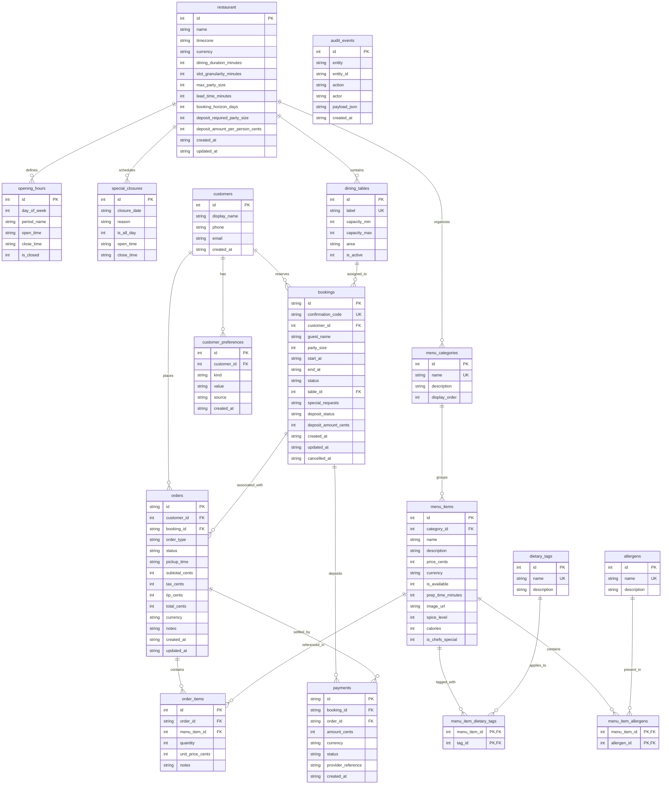

# TableTalk Data Model & Persistence Architecture

## 1. Overview & Database Architecture

TableTalk utilizes **SQLite** managed via **SQLx 0.8** as its primary relational datastore. The persistence layer is designed for deterministic voice-assisted dining workflows, providing ACID guarantees, foreign-key relational integrity, and zero external database infrastructure dependencies.

### 1.1 Database Access Strategy: Runtime Queries vs Compile-Time Checks

SQLx offers two primary query execution models:
1. **Compile-time checked queries (`sqlx::query!` / `query_as!`)** requiring `.sqlx/` offline metadata files or a live database during `cargo build`.
2. **Runtime queries (`sqlx::query_as`, `sqlx::query_scalar`, `sqlx::QueryBuilder`)** mapping columns into Rust structs deriving `sqlx::FromRow` and exhaustive `sqlx::Type` domain enums.

**Decision & Justification:**
TableTalk adopts **runtime queries** paired with strongly-typed `FromRow` structs, newtype identifiers, and domain enums. While `sqlx::query!` provides static query syntax checks, it requires offline metadata synchronization (`cargo sqlx prepare`) on every SQL modification and cannot support dynamic WHERE clause composition. Phase 6 mandates a flexible multi-predicate menu search engine combining arbitrary combinations of free text search, dietary filters, allergen exclusions, price thresholds, and availability flags—which fundamentally requires dynamic query construction via runtime query building. Runtime queries maintain full type safety at struct boundaries while eliminating brittle offline cache synchronization across diverse developer environments and CI runners.

### 1.2 SQLite PRAGMA Configuration & Embedded Migrations

To guarantee high read concurrency, data consistency, and crash resilience, every connection in the pool is initialized with strict PRAGMAs:
- `PRAGMA foreign_keys = ON`: Enforced on every connection to guarantee relational referential integrity.
- `PRAGMA journal_mode = WAL`: Write-Ahead Logging allows concurrent readers alongside active writers.
- `PRAGMA synchronous = NORMAL`: Balances durability with low write latency in WAL mode.
- `PRAGMA busy_timeout = 5000`: 5-second lock acquisition timeout prevents immediate `SQLITE_BUSY` errors under concurrent transactions.

Database migrations are embedded into the compiled binary via `sqlx::migrate!("./migrations")` in `backend/migrations/`. Migrations apply automatically upon server boot and database initialization, ensuring idempotent, version-controlled schema evolution.

---

## 2. Entity-Relationship (ER) Diagram



---

## 3. Table-by-Table Specifications

| Table | Description | Integrity Constraints & Indices |
|---|---|---|
| `restaurant` | Single-row establishment configuration and policy settings. | `CHECK(id = 1)`, positive duration/horizon constraints. |
| `opening_hours` | Operating schedule supporting split service shifts (lunch/dinner). | `CHECK(day_of_week BETWEEN 0 AND 6)`, `CHECK(is_closed = 1 OR open_time < close_time)`. Index on `day_of_week`. |
| `special_closures` | Date-specific holiday, maintenance, or private event closures. | `closure_date` ISO string, nullable partial-day hours. |
| `dining_tables` | Physical tables across restaurant floor zones. | `label` UNIQUE, `CHECK(capacity_min > 0)`, `CHECK(capacity_max >= capacity_min)`, `area IN ('indoor','patio','bar')`. |
| `menu_categories` | Display grouping for the menu. | `name` UNIQUE, `display_order` sorting index. |
| `menu_items` | Dishes, beverages, and desserts. | `category_id` FK (ON DELETE RESTRICT), `CHECK(price_cents >= 0)`, `spice_level BETWEEN 0 AND 3`. Index on `(category_id, is_available)`. |
| `dietary_tags` | Plant-based or religious dietary suitability tags. | `name` UNIQUE ('vegan', 'vegetarian', 'gluten_free', etc.). |
| `allergens` | Food allergens explicitly tracked for consumer safety. | `name` UNIQUE ('peanuts', 'tree_nuts', 'dairy', 'gluten', etc.). |
| `menu_item_dietary_tags` | Composite join table linking items to verified dietary tags. | Composite PK `(menu_item_id, tag_id)`, ON DELETE CASCADE. |
| `menu_item_allergens` | Composite join table linking items to contained allergens. | Composite PK `(menu_item_id, allergen_id)`, ON DELETE CASCADE. |
| `customers` | Synthetic demo profiles for returning diner memory. | Demo data; synthetic contacts. Real PII requires retention/consent policies. |
| `customer_preferences` | Memory tags (allergies, favorites, seating preferences). | `customer_id` FK (ON DELETE CASCADE), `kind IN ('allergy','dietary','seat_pref','favorite_item','note')`. Index on `customer_id`. |
| `bookings` | Table reservations with confirmation codes and deposits. | `id` UUID PK, `confirmation_code` UNIQUE, `CHECK(party_size > 0)`, `CHECK(end_at > start_at)`. Indices on `(table_id, start_at, end_at)` and `status`. |
| `orders` | Dine-in and pickup food orders. | `id` UUID PK, `CHECK(total_cents >= 0)`, `order_type IN ('dine_in','pickup')`. Indices on `customer_id` and `booking_id`. |
| `order_items` | Line items capturing price snapshots at order placement. | `order_id` FK (ON DELETE CASCADE), `menu_item_id` FK (ON DELETE RESTRICT), `CHECK(quantity > 0)`. |
| `payments` | Simulated payment ledger for deposits and settled orders. | `id` UUID PK, `CHECK(booking_id IS NOT NULL OR order_id IS NOT NULL)`. Never stores cardholder PAN data. |
| `audit_events` | Immutable historical event trail for state mutations. | `actor IN ('mcp','seed','system','admin')`. |

---

## 4. Conventions: Money and Time

### 4.1 Currency Representation
All financial amounts are strictly stored as **signed 64-bit integers in minor units** (`cents` or `paise`):
- ₹480.00 is stored as `48000` (paise).
- $25.50 is stored as `2550` (cents).
This eliminates binary floating-point representation rounding anomalies across all accounting, tax calculations, and payment summaries.

### 4.2 Timestamps and Timezone Conversions
- All database timestamps are stored in **UTC** formatted as standard **ISO-8601 strings** (`YYYY-MM-DDTHH:MM:SSZ` or `YYYY-MM-DDTHH:MM:SS+00:00`). This ensures unambiguous storage and deterministic lexicographical string sorting directly within SQLite.
- Local restaurant time is governed by the IANA timezone string in `restaurant.timezone` (defaulting to `Asia/Kolkata`).
- Conversions between local diner input and stored UTC timestamps are managed through `chrono` and `chrono-tz`. Midday services (12:30 IST -> 07:00 UTC) and midnight boundary crossings (00:30 IST Oct 21 -> 19:00 UTC Oct 20) are handled deterministically without DST or date drift errors.

---

## 5. Double-Booking Prevention & Concurrency Design

SQLite lacks PostgreSQL-style exclusion constraints (`EXCLUDE USING GIST`). To prevent overlapping reservations on the same table under concurrent requests, TableTalk implements an immediate transaction locking primitive:

```rust
// 1. Acquire connection and begin exclusive write lock
sqlx::query("BEGIN IMMEDIATE").execute(&mut *conn).await?;

// 2. Query for overlapping active reservations on the table
// Overlap condition: (new_start < existing_end) AND (new_end > existing_start)
let overlap_count: i64 = sqlx::query_scalar(
    r#"
    SELECT COUNT(*) FROM bookings
    WHERE table_id = ?
      AND status IN ('pending', 'confirmed')
      AND start_at < ?
      AND end_at > ?
    "#,
)
.bind(table_id)
.bind(end_at)
.bind(start_at)
.fetch_one(&mut *conn)
.await?;

// 3. Reject if conflicting reservation exists; otherwise commit
if overlap_count > 0 {
    sqlx::query("ROLLBACK").execute(&mut *conn).await?;
    return Err(DbError::TableConflict { table_id, start_at, end_at });
}

// 4. Insert booking and commit atomically
```

Because `BEGIN IMMEDIATE` acquires SQLite's `RESERVED` lock before reading the overlap count, concurrent requests are serialized. A concurrent reservation attempt waits until the first transaction completes, after which it evaluates the updated table state and fails with a descriptive `DbError::TableConflict`.

---

## 6. Seed Data & Allergen Safety Guarantees

The database includes realistic fictional seed data for **"The Saffron Nebula Bistro"**:
- **Operating Hours**: Monday through Sunday with lunch (12:00-15:30) and dinner (19:00-23:30) periods. Tuesdays are marked closed (`is_closed = 1`). One special closure is scheduled 14 days ahead for kitchen maintenance.
- **14 Dining Tables**: Distributed across Indoor (T01-T06, capacities 2 to 8), Patio (P01-P05, capacities 2 to 8), and Bar (B01-B03, capacities 1 to 4).
- **6 Categories & 35 Menu Items**: Realistic dishes spanning chaats, tandoor grills, curries, biryanis, breads, artisanal desserts, and teas. 2 items are flagged unavailable to test availability filtering.
- **Safety-Critical Allergen Integrity**:
  - Dietary tags (`vegan`, `vegetarian`, `gluten_free`, `dairy_free`, `halal`, `nut_free`) and allergens (`peanuts`, `tree_nuts`, `dairy`, `gluten`, `soy`, `sesame`, `mustard`, `shellfish`, `egg`, `fish`) are strictly separated into independent entities.
  - Zero items tagged `vegan` contain any animal allergens (`dairy`, `egg`, `fish`, `shellfish`).
  - Zero items tagged `gluten_free` contain the `gluten` allergen.
  - Zero items tagged `dairy_free` contain the `dairy` allergen.
  - Zero items tagged `nut_free` contain `peanuts` or `tree_nuts`.
- **5 Demo Customers**: Rohan Sharma (peanut allergy, vegetarian), Priya Patel (vegan, dairy allergy), Arjun Menon (gluten-free), Ananya Deshmukh (halal), and Vikramaditya Rao (shellfish allergy), with historical orders and upcoming reservations.

---

## 7. Known Limitations

1. **SQLite Write Concurrency**: SQLite supports a single active writer per database file. While WAL mode enables concurrent readers without blocking writes, high-frequency concurrent writes are serialized.
2. **Synthetic Demo Customers**: Customer records are purely synthetic with fictitious contact information (`+91-555-XXXX`, `@example.com`). Real-world customer records require explicit consent records and GDPR/data protection retention schedules.
3. **Simulated Payment Ledger**: The `payments` table represents a simulated accounting ledger. Cardholder Primary Account Numbers (PANs), CVVs, or live banking credentials must never be stored.

---

## 8. Availability Engine & Scheduling Rules (Phase 7)

### 8.1 Half-Open Overlap & Turnover Buffer Rule
Dining room reservations use half-open intervals:
$$\text{Existing Booking: } [S_{\text{existing}}, E_{\text{existing}} + B)$$
$$\text{Requested Slot: } [S_{\text{new}}, E_{\text{new}})$$
Where $B$ is the configurable `turnover_buffer_minutes` (defaulting to 0 minutes, configurable up to 15 minutes).

A table conflict exists if and only if:
$$(S_{\text{new}} < E_{\text{existing}} + B) \land (E_{\text{new}} > S_{\text{existing}})$$

**Exact Boundary Semantics**:
When $B = 0$, a request starting exactly at 19:00 ($S_{\text{new}} = 19:00$) does **not** overlap a booking ending at 19:00 ($E_{\text{existing}} = 19:00$), because $19:00 < 19:00$ is strictly false.

**Booking Status Filtering**:
Only bookings with status `pending` or `confirmed` block physical table capacity. Bookings marked `cancelled`, `no_show`, or `completed` do **not** block dining tables.

### 8.2 Seating Duration Rules
If the caller does not specify `duration_minutes`, duration is calculated deterministically by party size:
- **1–2 Guests**: 75 minutes
- **3–4 Guests**: 90 minutes (standard dining duration from `restaurant.dining_duration_minutes`)
- **5–6 Guests**: 105 minutes
- **7+ Guests**: 120 minutes

When supplied by the caller, `duration_minutes` is validated to remain bounded within $[30, 240]$ minutes.

### 8.3 Service Periods & Last-Seating Cutoff
Operating shifts are defined in `opening_hours` with distinct lunch and dinner periods. A booking is valid within a service period $[P_{\text{open}}, P_{\text{close}}]$ if:
1. $S_{\text{new}} \ge P_{\text{open}}$
2. **Last-Seating Rule**: $S_{\text{new}} \le P_{\text{close}} - 45\text{ minutes}$ (the party cannot be seated less than 45 minutes before closing).
3. **Closing Time Rule**: $S_{\text{new}} + \text{duration} \le P_{\text{close}}$ (the meal must completely conclude by the period closing time).

### 8.4 Deterministic Best-Fit Table Allocation
When multiple active tables satisfy $C_{\text{min}} \le \text{party\_size} \le C_{\text{max}}$ in the requested area without overlap, the engine allocates the table by:
1. **Smallest Sufficient Capacity**: $C_{\text{max}}$ ascending (avoids wasting an 8-top on a 2-top party).
2. **Area Priority**: Requested area match, then Indoor, Patio, Bar.
3. **Deterministic Identifier**: Table ID ascending.

### 8.5 Alternatives Search Limits & Tie-Breaking
When the requested slot is unavailable, the search algorithm proceeds with strict cost boundaries:
1. **Different Area at Requested Time**: If a specific area was requested, check other areas on the same date and time ($\Delta = 0\text{ minutes}$).
2. **Same-Day Outward Search**: Checks grid intervals outward up to `max_search_window_minutes = 120` (8 slots at 15-minute granularity).
   - **Documented Tie-Break**: Distance in time, then **later-before-earlier** ($+\Delta$ evaluated before $-\Delta$).
3. **Multi-Day Fallback**: If the requested date has zero available slots, the engine evaluates up to the next **3 open operating days** at the requested time (skipping closed days and special closures).
4. **Result Capping**: Returns at most `alternatives` slots (default 3, max 6).

