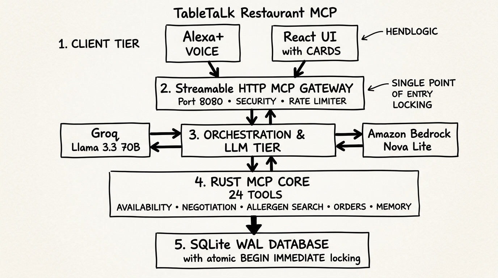
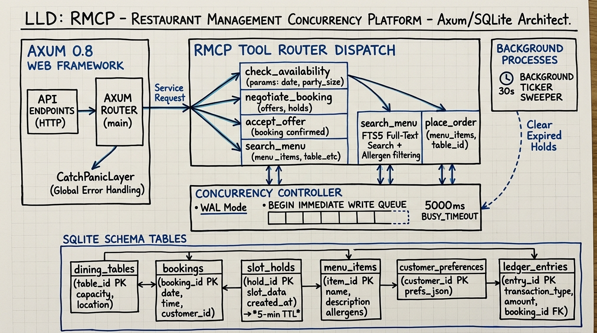
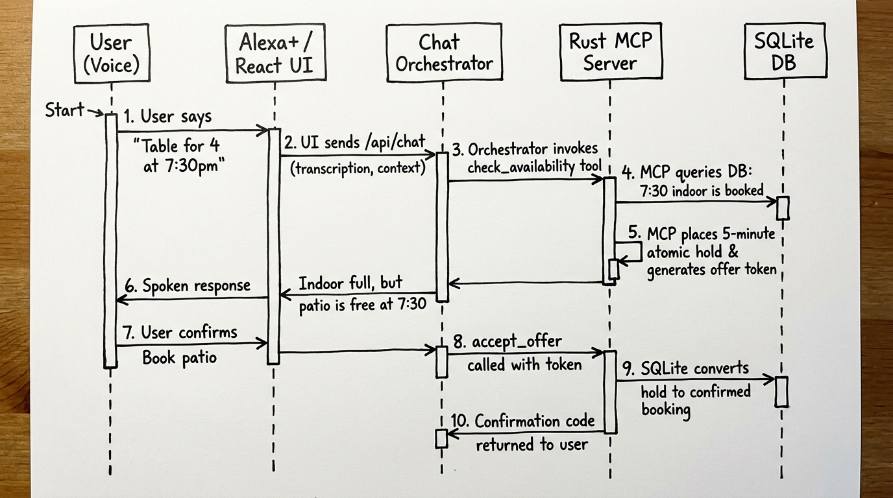
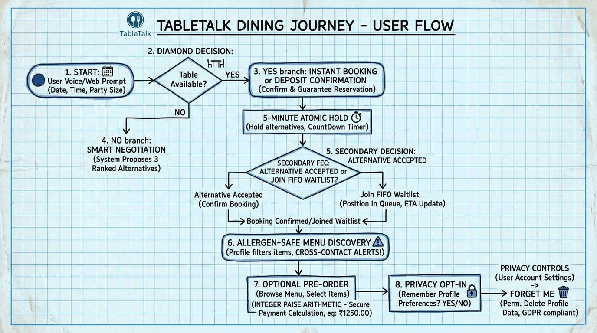
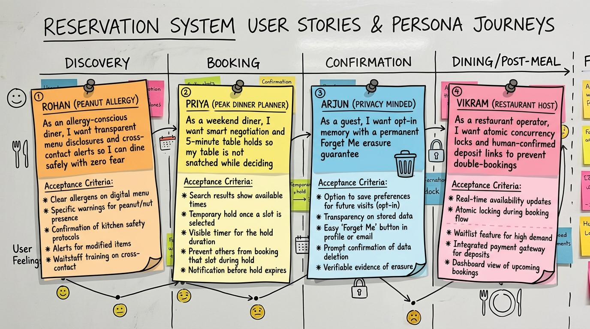

# TableTalk: System Design & Architecture Specification
**High-Level Design (HLD), Low-Level Design (LLD), Sequence Flows, User Flows & User Stories**

---

## Executive Summary

TableTalk is a production-grade restaurant intelligence platform implementing the **Model Context Protocol (MCP)** over Streamable HTTP (spec version `2025-11-25`). Written in Rust with Axum, Tokio, and SQLite WAL persistence, it powers voice-driven dining interactions, capacity negotiation, allergen-safe discovery, and frictionless bookings for voice assistants like Amazon Alexa+.

---

## 1. High-Level Design (HLD)

The system is organized into five decoupled tiers ensuring strict fault isolation, predictable latency, and defense-in-depth security.

### Tier Breakdown
1. **Client Tier**:
   - **Voice Assistant (Alexa+ / Voice Devices)**: Interacts directly via Streamable HTTP with natural voice speech and SSML prompts.
   - **React UI Client (Vite + shadcn/ui)**: Renders accessible, interactive cards driven by server `structuredContent`.
2. **Streamable HTTP MCP Gateway (Port 8080)**:
   - Validates client origins to eliminate DNS rebinding.
   - Enforces IP token-bucket rate limiting and strict 2MB request body caps.
   - Protects runtime stability via `CatchPanicLayer` and token redaction.
3. **Conversational AI & Orchestration Tier**:
   - Dispatches natural user intents using pluggable LLM backends: **Groq (Llama 3.3 70B)** for sub-300ms latency, and **Amazon Bedrock (Nova Lite)**.
   - Operates a deterministic multi-turn router when running hermetic offline test suites.
4. **Rust MCP Core (24 Tools)**:
   - Covers 5 distinct restaurant domains: Availability, Negotiation & Holds, Allergen-Safe Menu Search, Orders, and Privacy Memory.
5. **Storage & Concurrency Tier**:
   - SQLite with Write-Ahead Logging (WAL) and `BEGIN IMMEDIATE` transaction locking to guarantee zero table double-bookings under concurrent bursts.

---

## 2. Low-Level Design (LLD)

The internal architecture guarantees high throughput, deterministic state transitions, and memory safety without garbage collection overhead.

### Internal Modules & Concurrency Model
- **Axum 0.8 Web Framework**: Handles HTTP listener lifecycle, connection pooling, and global panic guards.
- **RMCP Tool Router Dispatch**: Strongly-typed dispatch to 24 domain tool modules:
  - `check_availability`: Evaluates restaurant opening hours, special closures, and table capacity matches.
  - `negotiate_booking`: Calculates alternative time slots and areas when primary target is unavailable.
  - `accept_offer`: Atomically claims held table offers using cryptographically signed tokens.
  - `search_menu`: SQLite FTS5 full-text search integrated with cross-contact risk filters.
  - `place_order`: Minor unit integer paise arithmetic preventing currency floating-point drift.
- **Concurrency Controller**:
  - `WAL Mode`: Reads never block writes; writes never block reads.
  - `BEGIN IMMEDIATE`: Serializes write transactions in queue with a 5000ms busy timeout.
  - `Background Ticker Sweeper (30s)`: Automatically cleans up expired 5-minute table holds and unconfirmed deposit sessions.

---

## 3. Sequence Diagram: Voice Booking & Negotiation Flow

The sequence diagram illustrates how TableTalk handles a peak Friday 7:30 PM booking request when the desired indoor table is already occupied.

### End-to-End Execution Trace
1. **User Voice Prompt**: User requests *"Table for 4 at 7:30 PM indoor"*.
2. **UI / Voice Forwarding**: Request forwarded to TableTalk `/api/chat`.
3. **Tool Invocation**: Orchestrator calls `check_availability(date, time, party_size: 4, area: indoor)`.
4. **Capacity Check**: Rust MCP server queries SQLite DB and detects all indoor 4-top tables (`T03`, `T04`, `T05`) are reserved.
5. **Atomic Hold Placement**: Server ranks available alternatives (Patio at 7:30 PM, Indoor at 9:00 PM), places a **5-minute atomic hold**, and issues an offer token.
6. **Conversational Negotiation**: Assistant speaks: *"I don't have indoor seating at 7:30 PM, but patio is free at 7:30 PM, or 9:00 PM indoor. Would either work for you?"*
7. **User Selection**: User confirms *"Book patio at 7:30"*.
8. **Offer Acceptance**: Client calls `accept_offer` passing the cryptographic hold token.
9. **Atomic Confirmation**: SQLite converts the hold into a confirmed booking.
10. **Confirmation Returned**: Confirmation code `TT-8102` is returned with visual card representation.

---

## 4. User Flow Diagram: The Complete Dining Journey

The end-to-end user journey bridges discovery, negotiation, dietary safety, and privacy preferences.

### Key Decision Branches
- **Direct Path**: Table available $\rightarrow$ Instant reservation or deposit link $\rightarrow$ Confirmed booking.
- **Negotiation Path**: Table booked $\rightarrow$ 3 ranked alternatives $\rightarrow$ 5-minute atomic hold $\rightarrow$ Accept alternative OR Join FIFO Waitlist.
- **Dietary & Allergen Filtering**: Menu discovery filters allergens and highlights cross-contact kitchen notices.
- **Privacy Controls**: Opt-in memory storage (`enable_memory`) paired with permanent 1-click `forget_me` erasure.

---

## 5. User Stories & Persona Journey Maps

Agile user stories capturing diner personas, pain points, and acceptance criteria.

### Persona 1: Rohan (Severe Peanut Allergy)
- **Role**: Allergy-Conscious Diner
- **Story**: *"As an allergy-conscious diner, I want transparent menu disclosures and cross-contact alerts so I can dine safely with zero fear."*
- **Acceptance Criteria**:
  - Prohibit misleading absolute claims like "100% safe" or "allergy-free".
  - Explicitly identify shared kitchen equipment risks.
  - Require diner acknowledgement before placing orders containing allergen tags.

### Persona 2: Priya (Weekend Dinner Planner)
- **Role**: High-Demand Slot Diner
- **Story**: *"As a weekend diner, I want smart negotiation and 5-minute table holds so my table is not snatched while deciding."*
- **Acceptance Criteria**:
  - Never return dead-end "No availability" messages.
  - Automatically calculate and rank up to 3 viable alternative slots.
  - Place a 5-minute lock on offered slots with countdown timer.

### Persona 3: Arjun (Privacy-Minded Diner)
- **Role**: Privacy-Conscious Guest
- **Story**: *"As a guest, I want opt-in memory with a permanent Forget Me erasure guarantee."*
- **Acceptance Criteria**:
  - Never retain preferences without explicit verbal or written consent.
  - Store profile tokens as cryptographic SHA-256 hashes.
  - Execute hard deletion of all customer preferences upon calling `forget_me`.

### Persona 4: Vikram (Restaurant Host & Operator)
- **Role**: Restaurant Operations Manager
- **Story**: *"As a restaurant operator, I want atomic concurrency locks and human-confirmed deposit links to prevent double-bookings and fraud."*
- **Acceptance Criteria**:
  - Zero double-bookings under concurrent client requests.
  - AI assistant never collects card data or approves payments directly.
  - Group deposits require human verification via secure payment session links.
